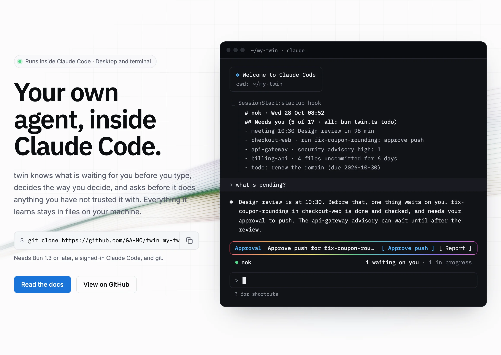
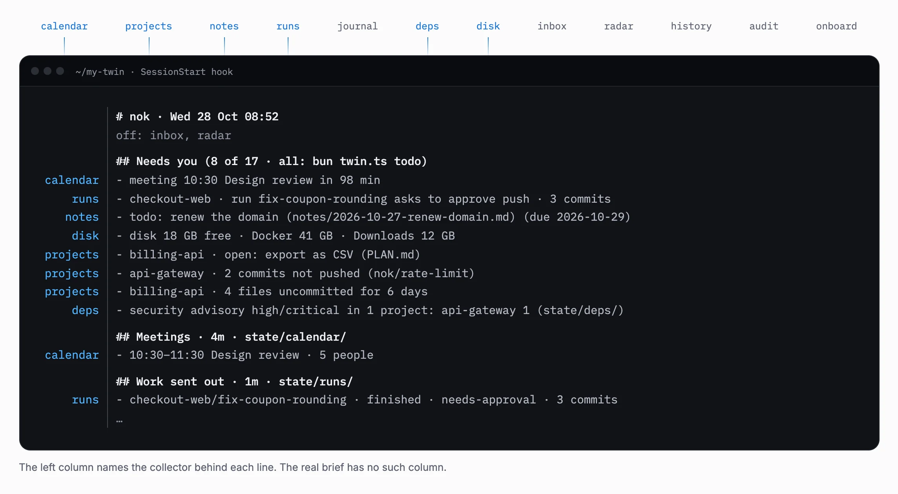
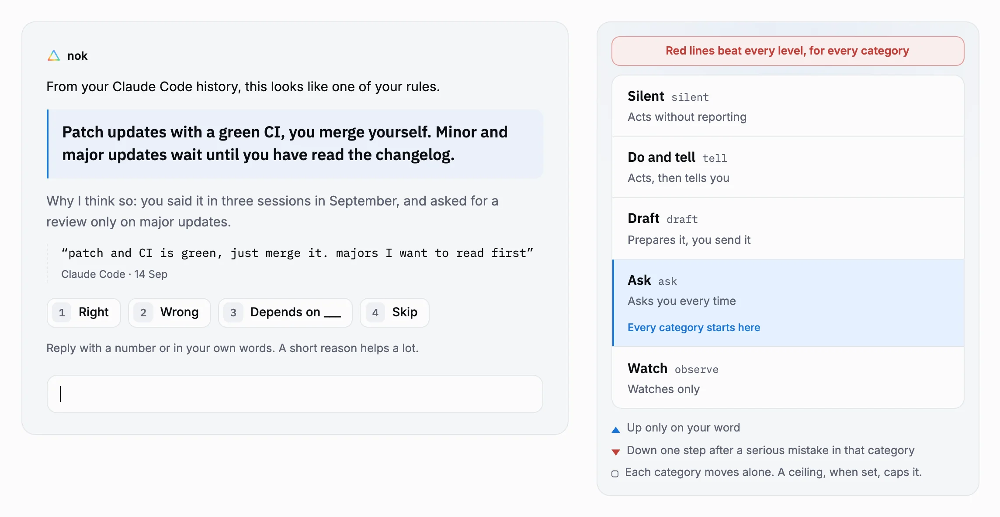
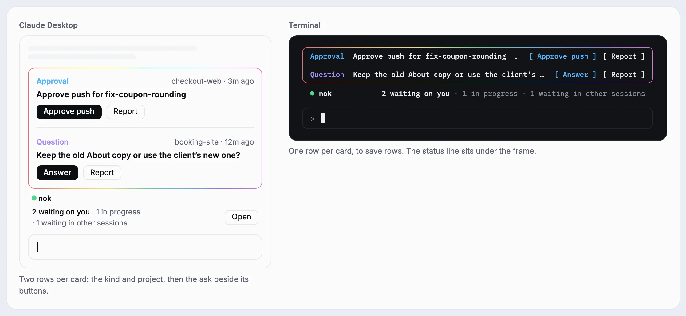
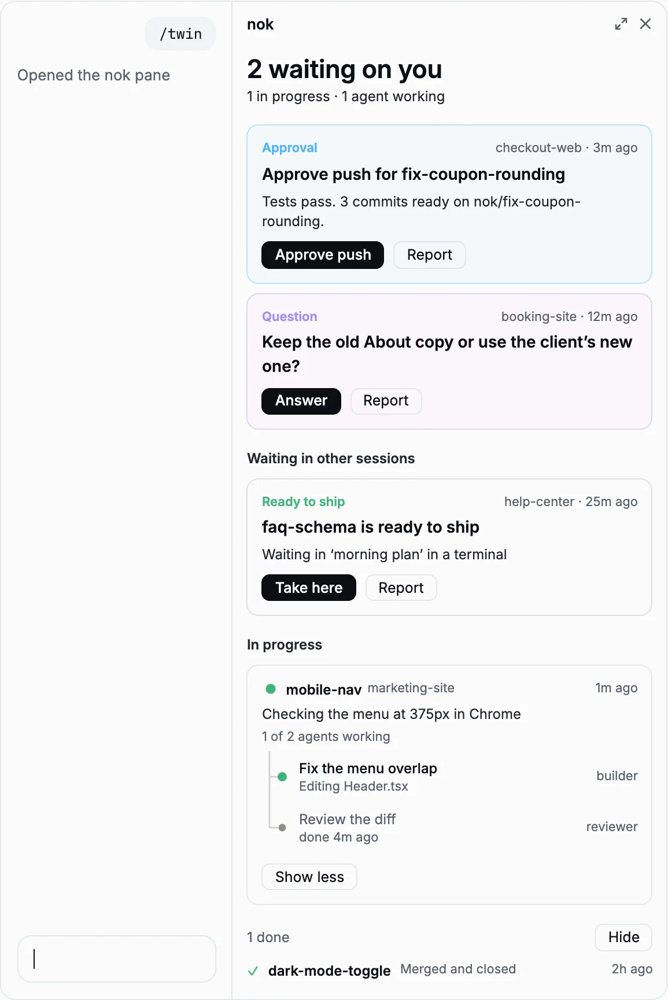

<p align="center">
  <a href="https://ga-mo.github.io/twin/"></a>
</p>

<h1 align="center">twin</h1>

<p align="center">
  <b>Your own agent, inside Claude Code.</b><br>
  It knows what is pending, decides the way you do,<br>
  and asks before it does anything you have not trusted it with.
</p>

<p align="center">
  <a href="https://ga-mo.github.io/twin/"></a>
  <a href="https://ga-mo.github.io/twin/docs"></a>
  
  
</p>

<p align="center">
  <a href="https://ga-mo.github.io/twin/"><b>Website</b></a> ·
  <a href="https://ga-mo.github.io/twin/docs/quick-start">Quick start</a> ·
  <a href="https://ga-mo.github.io/twin/docs">Documentation</a> ·
  <a href="README.th.md">ภาษาไทย</a>
</p>

<br>

<a href="https://ga-mo.github.io/twin/">
  <picture>
    <source media="(prefers-color-scheme: dark)" srcset=".github/readme/hero-dark.webp">
    
  </picture>
</a>

<p align="center"><a href="https://ga-mo.github.io/twin/"><b>See the whole tour on the website →</b></a></p>

---

twin is a repository you clone once. Open it in Claude Code (the Code tab in Claude Desktop, or `claude` in a terminal) and the session is your agent. It has read your meetings, projects, notes and running work before you type. It loads who you are from files only you own. It sends code work into your other repos as workers that cannot collide with what you are doing.

Nothing runs in the cloud. There is no daemon, no database and no server. Your identity, notes and journal stay on your machine and never reach the repo you pull updates from.

## Every session starts with a brief

Small collectors (calendar, projects, notes, runs, dependency advisories, disk, a daily news radar) read your day in the background. When a session opens, one hook ranks what they found into a short list, so the first answer comes from your day instead of an empty context. Turn each collector on or off.

<picture>
  <source media="(prefers-color-scheme: dark)" srcset=".github/readme/brief-dark.webp">
  
</picture>

## It learns how you decide

Type `onboard` on day one. With your yes, it reads your past Claude conversations, your claude.ai export or your commits, and proposes rules from what you actually did, one at a time, each with the quote it came from. With little history, it asks about real recent situations instead, five at a time. What it may do alone is set per category of work, and red lines are asked directly, never guessed.

<picture>
  <source media="(prefers-color-scheme: dark)" srcset=".github/readme/learn-dark.webp">
  
</picture>

## It works in your other repos, and stops where you would

"Fix X in Y" starts a headless worker in its own git worktree and branch, so the files you have open stay as they are. A pre-push hook lets it push only its own branch. A worker that changed UI without clicking, or code without trying inputs, gets one more check turn before it reports. Production has no approve button.

What needs you waits above the prompt, drawn the same in Claude Desktop and in the terminal.

<picture>
  <source media="(prefers-color-scheme: dark)" srcset=".github/readme/band-dark.webp">
  
</picture>

<picture>
  <source media="(prefers-color-scheme: dark)" srcset=".github/readme/panel-dark.webp">
  
</picture>

### Every run, in one pane

Press **Open** on the band or type `/twin`. A pane beside the chat lists:

- what waits on you, with the same buttons as the band
- what waits in other sessions, with **Take here** to move it into this one
- what is in progress, with each subagent and what it is doing
- what is done

[How the band and the pane work →](https://ga-mo.github.io/twin/docs/daily-use)

<br clear="right">

## Quick start

You need [Bun](https://bun.sh) 1.3 or later, [Claude Code](https://code.claude.com) logged in, and git. pstack, Baton and macOS are optional.

```bash
git clone https://github.com/GA-MO/twin.git my-twin
cd my-twin
bun install
bun twin.ts setup
```

`setup` asks for your agent's name, writes `profile/twin.json`, links your mode skill, adds one SessionStart hook (your existing hooks stay) and one import line to `~/.claude/CLAUDE.md` that loads your mode into every session, and schedules `sync` every 10 minutes and `daily` at 08:30 with launchd, cron or Task Scheduler. Running it again converges to the same state. Use `--scope project` to keep the hook and skill inside this repo only, and `--no-schedule` to skip the schedule.

Then open the folder in Claude Desktop's **Code** tab (or run `claude` in it) and type `onboard`.

Never used a terminal? The [install guide](https://ga-mo.github.io/twin/docs/install) walks through Bun, git and Claude Desktop on Mac and Windows step by step.

## Everyday use

| Type in Claude Code | You get |
|---|---|
| what's pending | an answer from the brief |
| remember … / remind me … | a note in `notes/` |
| a pasted meeting | decisions, your actions, work to hand off |
| fix X in &lt;project&gt; | a worker in that project's worktree that reports back |
| feedback: … / improve | changes to how the agent works and who it thinks you are |

`bun twin.ts` with no arguments lists every command. Tell it what it got wrong and `improve` turns that into changes. The number it watches is the share of handed-off work you never had to touch again.

## Your data

`profile/`, `notes/` and `journal/` are yours and gitignored. Every hour `sync` snapshots them into the local ref `refs/twin/backup` (not a branch). To back up off the machine, add a private remote named `backup` and it is pushed there as `twin-backup`, never to `origin`. API keys and tokens go in the OS secret store with `bun twin.ts secret <name>`, never in a file.

Read [Your data](https://ga-mo.github.io/twin/docs/concepts/your-data) for moving to a new machine and cleanup.

## Learn more

- [Concepts](https://ga-mo.github.io/twin/docs/concepts/identity): identity, the brief, dispatch, extending it with your own commands and collectors
- [CLI reference](https://ga-mo.github.io/twin/docs/reference/cli)
- [Design](https://ga-mo.github.io/twin/docs/design): why it is built this way, with the measurements behind each decision ([docs/design.md](docs/design.md) in the repo)

## Docs site

The site lives in [`site/`](site): Fumadocs on React Router and Vite, English and Thai, built to static files and deployed to GitHub Pages by [`.github/workflows/pages.yml`](.github/workflows/pages.yml). The README images are screenshots of its home page, in [`.github/readme/`](.github/readme).

```bash
cd site
bun install
bun run dev      # http://localhost:5173/twin/
bun run build    # static site in site/dist
bun run preview  # serve site/dist the way GitHub Pages does
```
