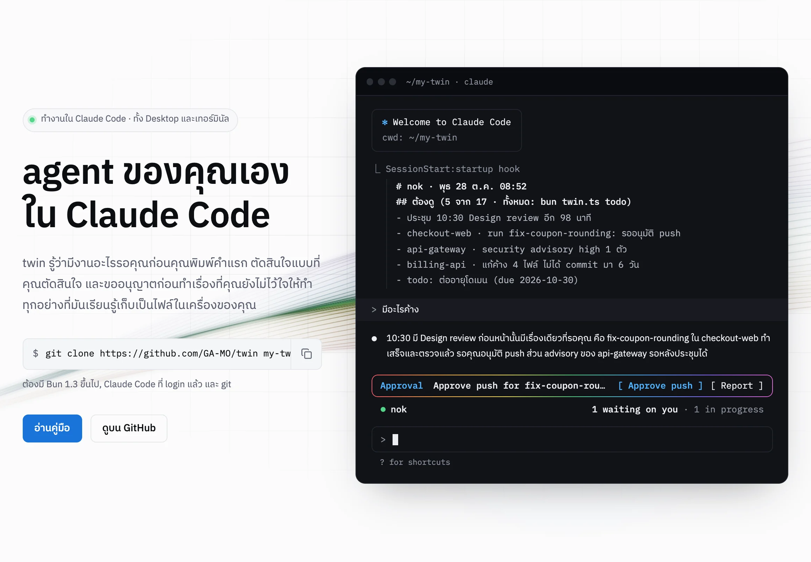
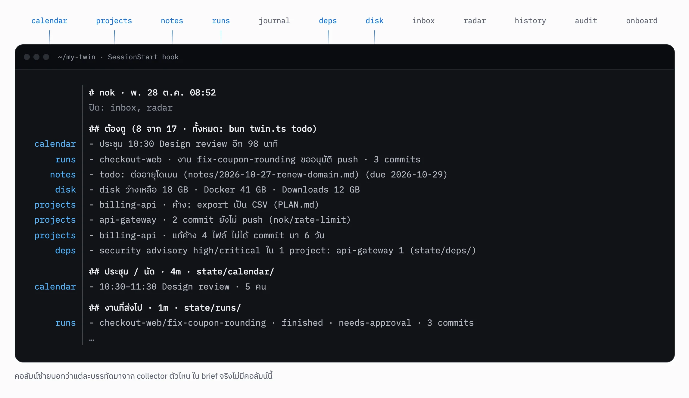
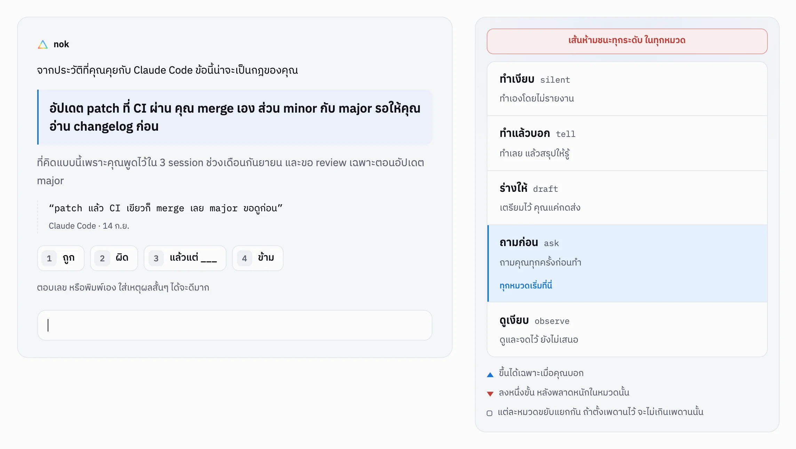
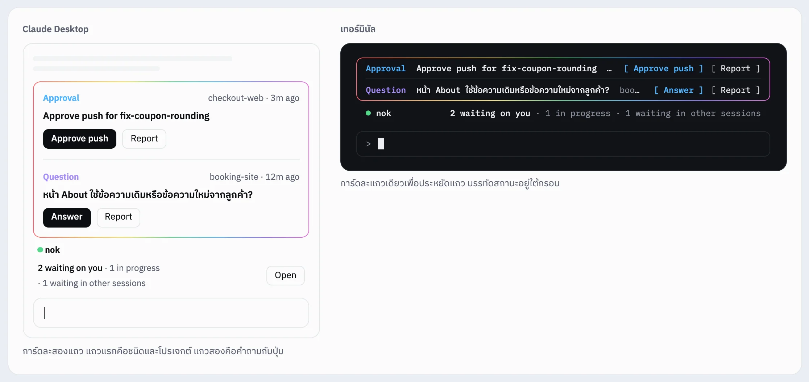
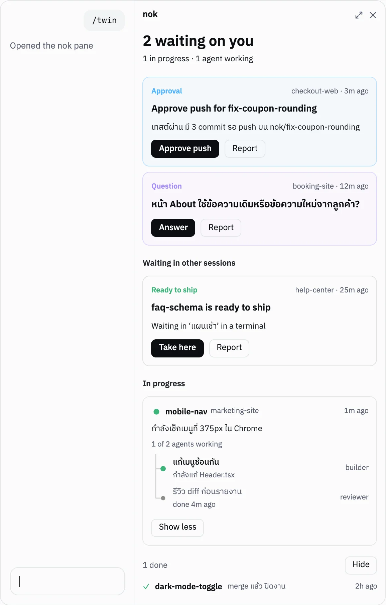

<p align="center">
  <a href="https://ga-mo.github.io/twin/th/"></a>
</p>

<h1 align="center">twin</h1>

<p align="center">
  <b>agent ของคุณเองใน Claude Code</b><br>
  รู้ว่ามีงานอะไรค้าง ตัดสินใจแบบคุณ<br>
  และขออนุญาตก่อนทำเรื่องที่คุณยังไม่ไว้ใจให้ทำ
</p>

<p align="center">
  <a href="https://ga-mo.github.io/twin/th/"></a>
  <a href="https://ga-mo.github.io/twin/th/docs"></a>
  
  
</p>

<p align="center">
  <a href="https://ga-mo.github.io/twin/th/"><b>เว็บไซต์</b></a> ·
  <a href="https://ga-mo.github.io/twin/th/docs/install">คู่มือติดตั้งทีละขั้น</a> ·
  <a href="https://ga-mo.github.io/twin/th/docs">เอกสาร</a> ·
  <a href="README.md">English</a>
</p>

<br>

<a href="https://ga-mo.github.io/twin/th/">
  <picture>
    <source media="(prefers-color-scheme: dark)" srcset=".github/readme/hero-dark.th.webp">
    
  </picture>
</a>

<p align="center"><a href="https://ga-mo.github.io/twin/th/"><b>ดูทั้งหมดบนเว็บไซต์ →</b></a></p>

---

twin คือ repo ที่คุณ clone ครั้งเดียว เปิดใน Claude Code (แท็บ Code ของ Claude Desktop หรือ `claude` ในเทอร์มินัล) แล้ว session นั้นคือ agent ของคุณ ก่อนคุณพิมพ์อะไร มันอ่านประชุม project โน้ต และงานที่ส่งไปแล้ว โหลดตัวตนของคุณจากไฟล์ที่เป็นของคุณคนเดียว และส่งงานโค้ดไปทำใน repo อื่นด้วย worker ที่ไม่ชนกับงานที่คุณทำอยู่

ไม่มีอะไรรันบน cloud ไม่มี daemon ไม่มีฐานข้อมูล ตัวตน โน้ต และ journal ของคุณอยู่ในเครื่องคุณ และไม่ถูกส่งไปที่ repo ต้นทางที่คุณ `git pull`

## เปิดคุยครั้งไหน ก็เริ่มจาก brief

collector ตัวเล็กๆ (ปฏิทิน, project, โน้ต, run, ช่องโหว่ของ dependency, disk, ข่าวรายวัน) อ่านวันของคุณไว้ในเบื้องหลัง พอเปิด session hook ตัวเดียวจะเรียงทุกอย่างที่เจอเป็นรายการสั้นๆ คำตอบแรกจึงมาจากวันของคุณจริง ไม่ได้เริ่มจากศูนย์ เปิดปิด collector แต่ละตัวได้เอง

<picture>
  <source media="(prefers-color-scheme: dark)" srcset=".github/readme/brief-dark.th.webp">
  
</picture>

## มันเรียนรู้ว่าคุณตัดสินใจอย่างไร

วันแรกพิมพ์ `onboard` ถ้าคุณอนุญาต มันจะอ่านประวัติที่คุณเคยคุยกับ Claude ไฟล์ export จาก claude.ai หรือ commit ของคุณ แล้วเสนอกฎจากสิ่งที่คุณทำจริงทีละข้อ พร้อมข้อความที่คุณเคยพิมพ์เป็นหลักฐาน ถ้ามีประวัติน้อย มันจะถามจากสถานการณ์จริงที่เพิ่งเกิดแทน ครั้งละ 5 ข้อ อะไรที่มันทำเองได้ตั้งแยกตามหมวดงาน ส่วนเส้นห้ามข้ามจะถามคุณตรงๆ ไม่เดาเอง

<picture>
  <source media="(prefers-color-scheme: dark)" srcset=".github/readme/learn-dark.th.webp">
  
</picture>

## ทำงานใน repo อื่นให้ และหยุดตรงที่คุณจะหยุด

"ไปแก้ X ใน Y" จะเริ่ม worker แบบ headless ใน git worktree และ branch ของมันเอง ไฟล์ที่คุณเปิดอยู่ไม่ถูกแตะ pre-push hook ยอมให้มัน push แค่ branch ของตัวเอง worker ที่แก้ UI แต่ไม่ได้คลิก หรือแก้โค้ดแต่ไม่ได้ลอง input จะถูกส่งกลับไปตรวจอีกหนึ่งรอบก่อนรายงาน และ production ไม่มีปุ่มอนุมัติ ขั้นนั้นคุณทำเอง

อะไรที่รอคุณจะขึ้นเหนือช่องพิมพ์ หน้าตาเหมือนกันทั้งใน Claude Desktop และในเทอร์มินัล

<picture>
  <source media="(prefers-color-scheme: dark)" srcset=".github/readme/band-dark.th.webp">
  
</picture>

<picture>
  <source media="(prefers-color-scheme: dark)" srcset=".github/readme/panel-dark.th.webp">
  
</picture>

### ทุกงานในแผงเดียว

กด **Open** บนแถบ หรือพิมพ์ `/twin` แผงข้างแชตจะแสดง:

- งานที่รอคุณ ปุ่มเหมือนบนแถบ
- งานที่รออยู่ใน session อื่น กด **Take here** เพื่อย้ายมาทำต่อที่นี่
- งานที่กำลังทำ พร้อม subagent แต่ละตัวว่าทำอะไรอยู่
- งานที่เสร็จแล้ว

[วิธีใช้แถบและแผง →](https://ga-mo.github.io/twin/th/docs/daily-use)

<br clear="right">

## เริ่มใช้

ต้องมี [Bun](https://bun.sh) 1.3 ขึ้นไป, [Claude Code](https://code.claude.com) ที่ login แล้ว และ git ส่วน pstack, Baton หรือ Mac มีก็ใช้ ไม่มีก็ทำงานได้

```bash
git clone https://github.com/GA-MO/twin.git my-twin
cd my-twin
bun install
bun twin.ts setup            # ถามชื่อ agent แล้วตั้งค่าเครื่องให้
```

ไม่เคยใช้เทอร์มินัล: ทำตาม[คู่มือติดตั้งทีละขั้น](https://ga-mo.github.io/twin/th/docs/install) (ติดตั้ง Bun, Claude Desktop, git บน Mac และ Windows) หรือเปิด [docs/SETUP.md](docs/SETUP.md)

แล้วเปิดคุยกับ agent ทางใดทางหนึ่ง:

- **Claude Desktop (Mac และ Windows)**: เปิดแอป Claude → แท็บ **Code** → เลือกโฟลเดอร์ (Select folder) แล้วชี้ไปที่โฟลเดอร์ `my-twin` → เริ่มคุยในโฟลเดอร์นั้น ครั้งแรกแอปจะถามว่าไว้ใจโฟลเดอร์นี้ไหม ให้กดไว้ใจ ทุกครั้งที่เปิดคุยในโฟลเดอร์นี้ agent จะโหลดตัวตนของคุณและสรุปงาน (brief) ให้เอง
- **Terminal**: `cd my-twin && claude`

แท็บ Chat ของ Claude Desktop ไม่ได้ต่อกับ agent นี้ ให้ใช้แท็บ Code

ครั้งแรกพิมพ์ `onboard`: agent จะขออนุญาตอ่านประวัติที่คุณเคยคุยกับ Claude ก่อน (ให้หรือไม่ให้ก็ได้) ถ้ามีประวัติเยอะ มันจะเดากฎของคุณจากประวัติแล้วให้คุณกด ถูก / ผิด / แล้วแต่ ถ้ามีน้อย มันจะถามทีละข้อเป็นสถานการณ์จริง ชุดละ 5 ข้อ หยุดได้ทุกเมื่อ จากนั้นมันจะถามเพิ่มวันละ 1-3 ข้อในเรื่องที่ยังรู้จักคุณน้อย

ใช้ claude.ai บนเว็บหรือมือถือเป็นหลัก: Settings → Privacy → Export data แล้วแตกไฟล์ที่ได้ทางอีเมล เอา `conversations.json` ไปวางในโฟลเดอร์ `my-twin/profile/imports/` agent จะถามก่อนอ่าน

<details>
<summary><code>setup</code> ทำอะไรบ้าง (รันซ้ำได้ ผลเหมือนเดิม)</summary>

- เขียน `profile/twin.json`: ชื่อ agent, OS, โฟลเดอร์ code (`--dev <path>`), เครื่องมือที่ตรวจเจอ, collector ที่เปิด
- ลิงก์ `profile/mode` ไปที่ `~/.claude/skills/<ชื่อ>-mode`
- เพิ่ม SessionStart hook หนึ่งตัวใน `~/.claude/settings.json` (hook เดิมของคุณยังอยู่) และบรรทัด import หนึ่งบรรทัดใน `~/.claude/CLAUDE.md` ที่โหลดตัวตนเข้าทุก session หรือใส่ `--scope project` เพื่อให้ hook กับ skill อยู่ใน repo นี้อย่างเดียว เหมาะกับเครื่องที่มี agent อื่นอยู่แล้ว
- เปิดแถบสถานะงาน (mod) ให้ repo นี้ใน `.claude/settings.local.json`
- ตั้งตารางเวลา sync ทุก 10 นาทีและ daily 08:30: launchd บน Mac, cron บน Linux, Task Scheduler บน Windows (`--no-schedule` เพื่อข้าม; Windows ยังไม่ได้ทดสอบบนเครื่องจริง)

</details>

## ใช้ทุกวัน

| พิมพ์ใน claude | ได้ |
|---|---|
| มีอะไรค้าง | ตอบจาก brief |
| จำไว้ว่า … / เตือน … | โน้ตใน `notes/` |
| สรุปประชุม + วางโน้ต | การตัดสินใจ, action, งานที่ต้องส่งต่อ |
| ไปแก้ X ใน &lt;project&gt; | worker ทำใน worktree ของ project นั้น แล้วรายงานกลับ |
| จด feedback: … / improve | ปรับตัวตนและการทำงานจากที่คุณแก้ |

`bun twin.ts` (ไม่มี argument) แสดงคำสั่งทั้งหมด บอกว่าผิดตรงไหน `improve` จะปรับตัว ตัวเลขที่มันดูคือสัดส่วนงานที่ส่งไปแล้วคุณไม่ต้องกลับไปแตะอีก

## ข้อมูลของคุณ

`profile/`, `notes/`, `journal/` เป็นของคุณ อยู่ในเครื่องคุณ ไม่ถูก commit ลง branch ที่คุณ `git pull` จาก repo ต้นทาง และไม่ถูก push ไปที่นั่น ทุกชั่วโมง `sync` เก็บ snapshot ไว้ใน ref `refs/twin/backup` ในเครื่อง (ไม่ใช่ branch) ถ้าอยากสำรองนอกเครื่อง: สร้าง repo private แล้ว `git remote add backup <url>` ระบบจะ push ไปเป็น branch `twin-backup` ที่นั่นเอง

ย้ายเครื่อง: clone repo นี้ใหม่ แล้ว `git remote add backup <url> && git fetch backup twin-backup && git checkout FETCH_HEAD -- profile notes journal && git reset -q` ก่อน `bun twin.ts setup`

ลบ node_modules ใน repo ที่ไม่แตะ 14 วันและ cache เครื่องมืออัตโนมัติทุกเช้า: เปิดเองด้วย `bun twin.ts profile autoClean=on` (ปิดไว้ก่อน)

API key หรือ token: `bun twin.ts secret <ชื่อ>` เก็บใน Keychain / Credential Manager / libsecret ของเครื่อง ไม่เขียนลงไฟล์

## อ่านต่อ

- [แนวคิด](https://ga-mo.github.io/twin/th/docs/concepts/identity): ตัวตน, brief, dispatch, เพิ่มคำสั่งและ collector ของคุณเอง
- [คำสั่งทั้งหมด](https://ga-mo.github.io/twin/th/docs/reference/cli)
- [การออกแบบ](https://ga-mo.github.io/twin/th/docs/design): ทำไมออกแบบแบบนี้ พร้อมตัวเลขที่วัดได้เบื้องหลังแต่ละการตัดสินใจ ([docs/design.md](docs/design.md))
